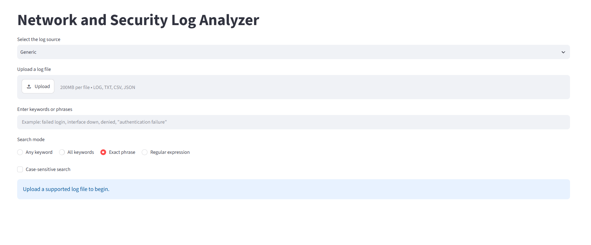
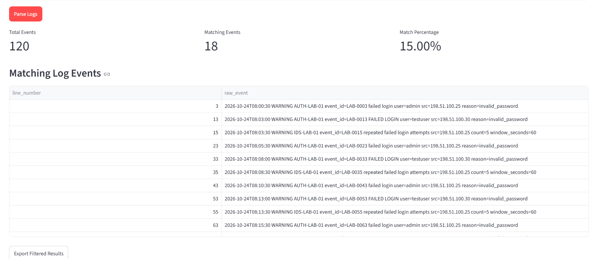
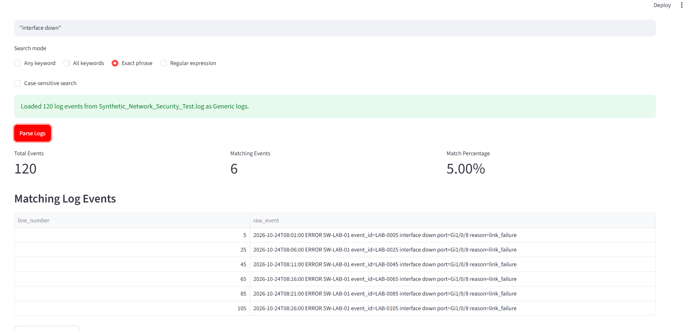
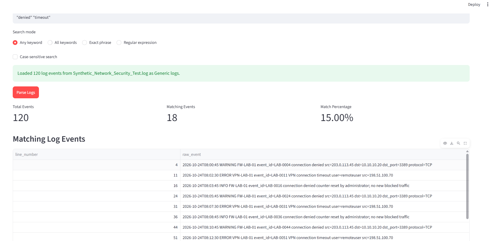

# Network and Security Log Analyzer

A Python and Streamlit application for searching uploaded logs and reviewing matching network and security events through a browser interface.

**Author:** Andrei Taylor | [GitHub](https://github.com/theonedre)

## Project purpose

Network troubleshooting and security investigations often start with large volumes of raw log messages. This project provides an interactive way to narrow those messages to relevant events, retain line numbers for text logs and sequential event numbers for CSV/JSON, and export filtered results for further review.

The project demonstrates Python application development, text filtering, regular expressions, and practical SOC/NOC investigation workflows.

## Features

- Browser interface built with Streamlit.
- Read LOG/TXT as text lines, CSV as rows, and JSON as JSON Lines with a standard JSON fallback.
- Combine structured fields into searchable raw-event text.
- Select a log-source label for the uploaded data; this does not change parsing behavior.
- Any keyword, all keywords, exact phrase, and regular expression search modes.
- Optional case-sensitive matching.
- Total event count, matching event count, and match percentage.
- Results table showing original line numbers and raw events.
- Export Filtered Results control.

## Screenshots

### Application interface



### Failed login results

The synthetic dataset produces 18 matching events out of 120 (15%), including lowercase and uppercase failed-login messages.



### Interface outage results

The exact-phrase interface-down search returns 6 matching events (5%).



### Denied traffic and timeout results

An any-keyword search for denied and timeout returns 18 matching events (15%). One matching message describes a counter reset rather than a new blocked connection, illustrating why keyword hits require contextual review.



## Installation on Windows

Install Python, download or clone the repository, and open PowerShell in the project folder.

```powershell
python -m venv .venv
& ".\.venv\Scripts\python.exe" -m pip install -r requirements.txt
& ".\.venv\Scripts\python.exe" -m streamlit run ".\script.py"
```

Open the local URL printed in the terminal, usually http://localhost:8501. Keep the terminal running while using the application. Stop it with Ctrl+C.

Run the application through Streamlit. Launching script.py directly with Python produces missing ScriptRunContext warnings and does not provide the intended app session.

## Try the sample data

1. Select **Generic** as the log source.
2. Upload `sample_logs/Synthetic_Network_Security_Test.log`.
3. Enter a query and select a search mode.
4. Leave case-sensitive search unchecked for the baseline checks below.
5. Click **Parse Logs** and inspect the results.

| Search mode | Query | Expected matches | Percentage |
| --- | --- | ---: | ---: |
| Exact phrase | `"failed login"` | 18 | 15% |
| Exact phrase | `"interface down"` | 6 | 5% |
| Any keyword | `"denied" "timeout"` | 18 | 15% |
| Regular expression | `ERROR\|CRITICAL` | 24 | 20% |

The first three results are documented in the supplied screenshots. The regular-expression count is an expected sample-data check, not a screenshot-verified application result. With case-sensitive matching enabled, lowercase `failed login` should match 12 entries.

The sample contains 120 fully synthetic events spanning authentication, firewall, switching, VPN, DNS, backups, and monitoring. It contains no production logs or credentials.

## Technology

- Python
- Streamlit
- pandas
- openpyxl

The application uses Streamlit and pandas directly, alongside the Python standard library. openpyxl was part of the original setup but is not required by this version; Excel upload is not implemented.

## Limitations

This is a file-based log search project. Matching text does not establish malicious activity. Results require analyst review. Live collection, automated correlation, and response actions have not been demonstrated. The source selector labels the data and does not implement vendor-specific parsing. Search terms are separated by whitespace; use double quotes to group phrases. Commas are treated as literal characters, so enter `denied timeout` rather than `denied, timeout`. For structured input, the displayed line_number is a sequential row number rather than an original source-file line. Input columns named line_number or raw_event may conflict with generated columns.

## Possible future improvements

- Extract timestamps, IP addresses, severity, and usernames into dedicated columns.
- Add time-range filters and event summaries.
- Add automated tests for search modes and malformed input.
- Add vendor-specific parsing and clearer input validation.

## Repository contents

- `script.py`: Streamlit application.
- `requirements.txt`: direct third-party dependencies.
- `sample_logs/`: synthetic test dataset.
- `docs/screenshots/`: application screenshots embedded above.

## Validation

The uploaded source passed Python syntax validation. The screenshots document the three sample searches described above. Full application execution and dependency compatibility were not independently tested in this environment.
